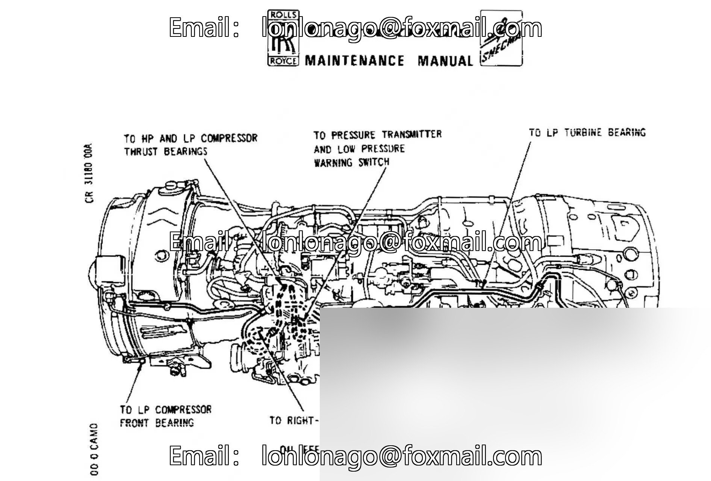
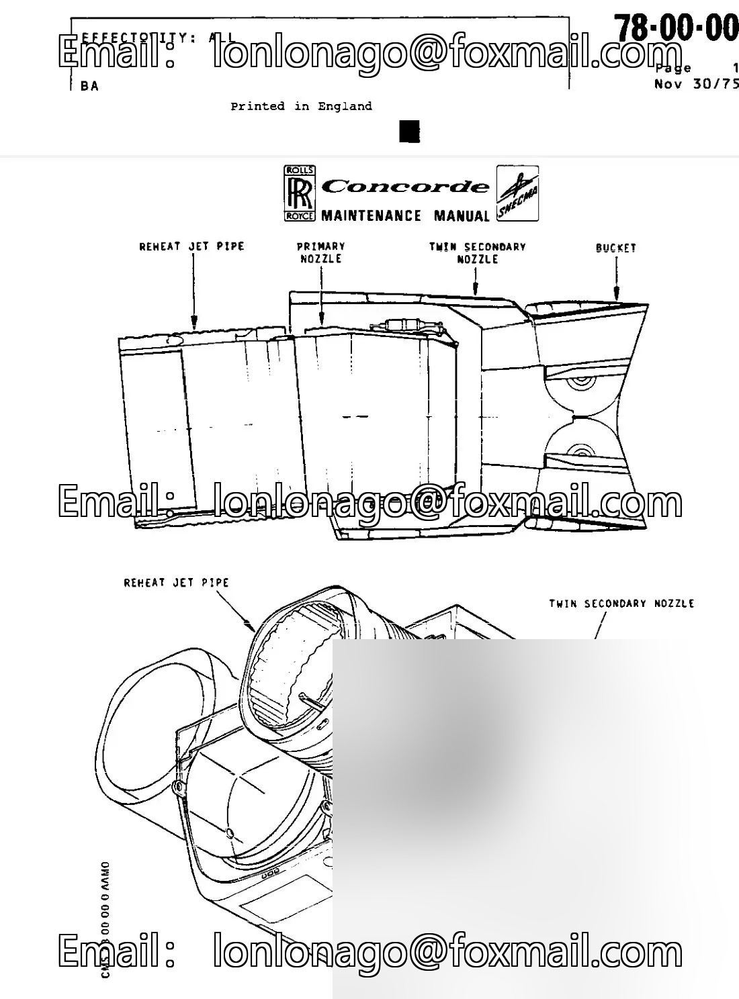
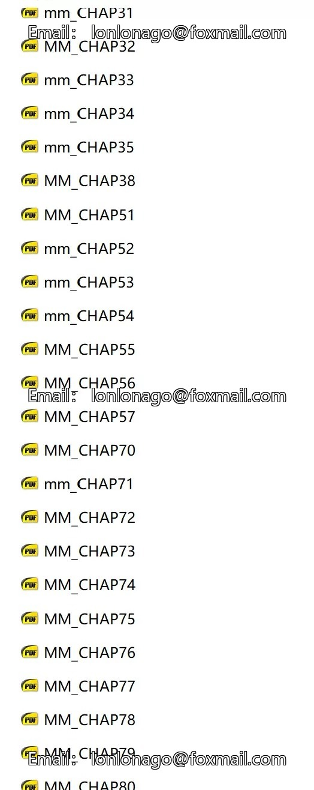
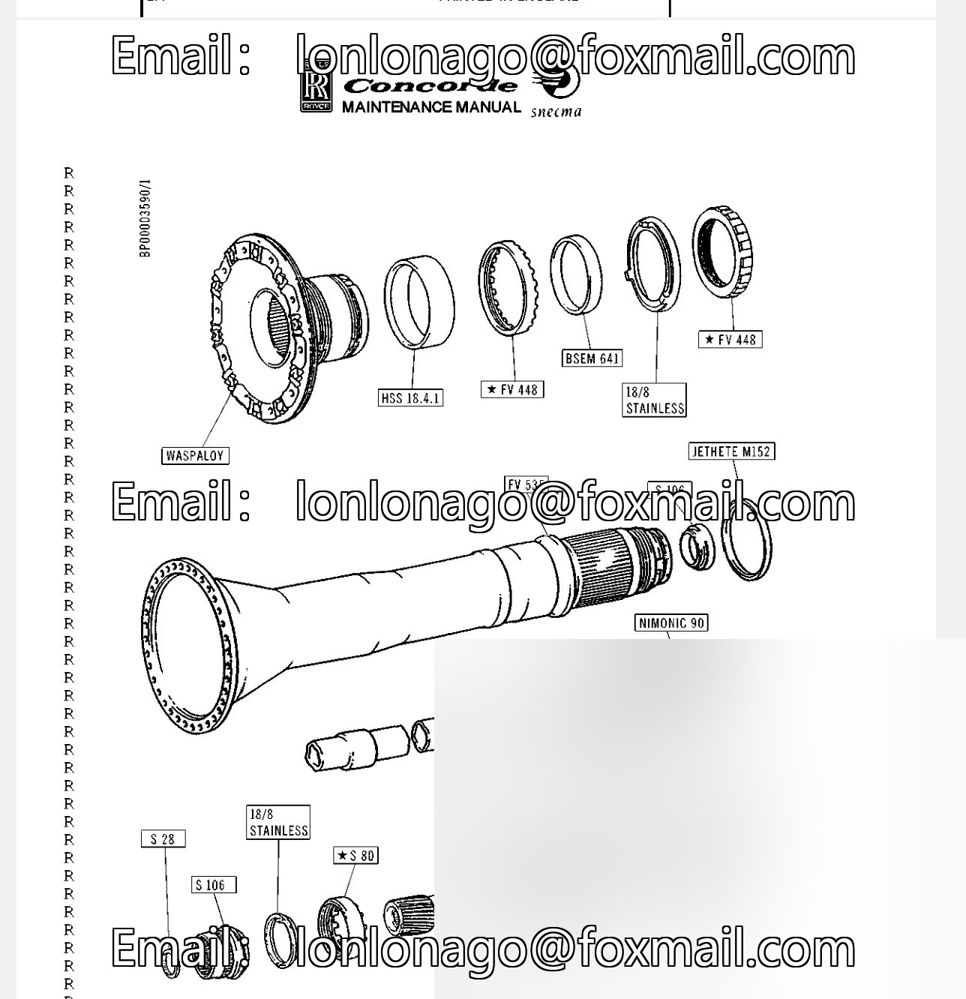

# Concert plane maintenance manual full set technical materials design materials

## Body

The Complete Concorde Aircraft Maintenance Manual Set: Technical Materials and Design Assets. The Concorde (Concorde) *Maintenance Manual* set consists of 71 PDFs, approximately 1.1 GB, jointly compiled by SNECMA (Safran, a French group) and Rolls-Royce (Rolls-Royce, a British group).

1. Overview of manual content
71 PDF documents Completely records the maintenance and preservation standards for the Concorde supersonic passenger aircraft. Content covers the engine Body, Maintenance procedures for critical systems such as landing gear, etc. Failure diagnosis and resolution methods Regular inspection and maintenance schedule List of repair tools and equipment.

2. Document characteristics
Detailedness: comprehensive, suitable for reference by aviation maintenance engineers, flight crew personnel, and aviation academia teachers and students.

3. Publishing information
November 1975, the original UK edition was issued, the paper version has been out of print, and the is now being circulated.

are copyable and non-refundable upon sale.

The complete Concorde maintenance manual consists of 71 PDF documents, including technical materials and design assets; it covers maintenance standards for the engine, fuselage, landing gear and other key systems, fault diagnosis and troubleshooting, regular inspection and maintenance schedules, as well as maintenance tools and equipment lists.

<!-- AI_ENRICHED -->

## Images

## Payment

Here is a pay link on Stripe ( https://buy.stripe.com/3cs8yP7sY87d0vu9AB ). Please contact me lonlonago@foxmail.com after funding $89, and I will send you a complete data files , thank you!

